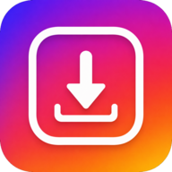

<div align="center">
  

  <h1>Instasave</h1>

  <p><strong>Download photo, carousels and videos from Instagram</strong></p>

  <p>
    
    
  </p>
</div>

## Features
Native Android app for analyzing public Instagram permalinks and saving photos, videos, or selected carousel items to the device's `Download/Instasave` folder.

- Paste an Instagram link or receive one through Android's share sheet.
- Download without leaving Instagram with the floating bubble: copy a post's link, tap the bubble, and save it from a compact sheet shown over the app.
- Analyze public posts, reels, and carousels.
- Preview content before downloading it.
- Select individual items from a carousel.
- Keep a local history of initiated downloads, with local file availability and previews.
- Show relative download time (`Downloaded just now`, minutes, hours, or days ago); expanded history refreshes as the time changes.
- Available in English, Italian, French, and Spanish, following the device language.

### Floating bubble

Enable **Floating bubble** at the bottom of the main screen. The first time, Android asks for notifications (used for the bubble's *Hide bubble* action) and for permission to display over other apps. While enabled, a foreground service keeps a draggable bubble on screen that snaps to the nearest edge. To hide it, drag it onto the ✕ that appears at the bottom of the screen, turn off the switch, or use *Hide bubble* in its notification.

In Instagram, tap **Share → Copy link**, then tap the bubble: Instasave reads the link from the clipboard, shows a preview, and downloads every item (for carousels, *Open in Instasave* lets you pick individual items). Since Android 10 only the focused app can read the clipboard, so the bubble opens a translucent sheet instead of reading it from the background service. Bubble downloads appear in the app's history.

The app uses only publicly available data and does not require an Instagram login. Content availability depends on Instagram and the post's privacy settings.

## Requirements

- Android Studio or the Android SDK.
- JDK 17.
- Android SDK Platform 34.
- Gradle Wrapper 8.2.1, included in this repository.

Android configuration:

| Item | Value |
| --- | --- |
| Application ID | `app.instasave` |
| Min SDK | 26 (Android 8.0) |
| Target / Compile SDK | 34 |
| Language | Java |

## Build

From the project root:

```bash
./gradlew :app:assembleDebug
```

The APK is generated at:

```text
app/build/outputs/apk/debug/instasave-debug.apk
```

To use only dependencies already available in the local cache:

```bash
./gradlew :app:assembleDebug --offline --no-daemon --console=plain
```

## Install on an Emulator or Device

To build, start the default emulator (`Pixel_5`), install, and open the app in one command:

```bash
./run-emulator.sh
```

To use another AVD, pass its name:

```bash
./run-emulator.sh Medium_Phone_API_35
```

The script uses `ANDROID_SDK_ROOT`/`ANDROID_HOME` when set, otherwise `~/Android/Sdk`.

With an Android device connected and ADB available:

```bash
adb install -r app/build/outputs/apk/debug/instasave-debug.apk
adb shell monkey -p app.instasave 1
```

## Project Structure

```text
app/src/main/
  java/app/instasave/
    MainActivity.java       # Coordinates link analysis and app components
    MediaResolver.java      # Public media resolution
    ImageLoader.java        # Remote/local thumbnail loading and cache
    HistoryRepository.java  # Local download history persistence
    HistoryController.java  # History rendering, local file access, and age refresh
    PreviewController.java  # Content preview and carousel item selection
    DownloadController.java # JPEG saves, DownloadManager requests, and completion state
    BubbleService.java      # Floating bubble shown over other apps (foreground service)
    QuickDownloadActivity.java # Sheet opened by the bubble: clipboard link, preview, download
  res/
    layout/                 # XML layouts
    drawable/               # UI styles and resources
    mipmap-*/               # Launcher icon at each density
  assets/branding/
    logo.png                # High-resolution source logo
```

`assets/branding/logo.png` is the high-resolution source logo file. It is excluded from APK
packaging; the optimized copies in `res/mipmap-*` are used by Android for the launcher icon and
the logo shown in the app header.

## Usage and Disclaimer

Instasave is a personal hobby project, provided for educational and personal use only. It is not affiliated with, endorsed by, or sponsored by Instagram or Meta.

Use it only for content you own or for which you have explicit permission to download and retain. You are responsible for complying with the platform's terms, applicable law, and the rights of content owners. This project does not include Instagram credentials, cookies, access tokens, or downloaded content.

Availability may change without notice because it depends on third-party services and their policies.

## License

This project is licensed under the [GNU General Public License v3.0](LICENSE).
